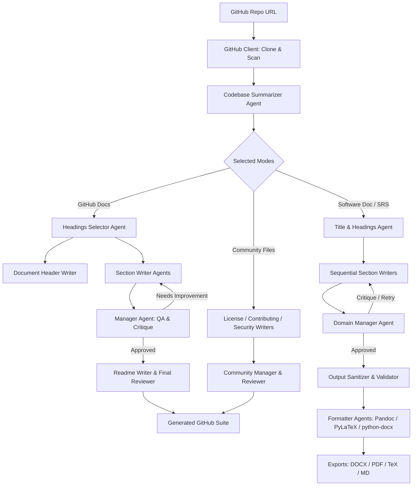

# 🖋️ CodeScribe AI

<p align="center">
  <strong>Autonomous Multi-Agent AI Documentation Engine for Modern Software Repositories</strong>
</p>

<p align="center">
  Transform any GitHub repository into production-grade GitHub community suites, comprehensive technical documentation, and IEEE 830-compliant Software Requirements Specifications (SRS) in seconds.
</p>

<p align="center">
  <a href="https://github.com/Light01ongithub/CodeScribe-AI/blob/main/LICENSE">
    
  </a>
  <a href="https://www.python.org/">
    
  </a>
  <a href="https://fastapi.tiangolo.com/">
    
  </a>
  <a href="https://react.dev/">
    
  </a>
  <a href="https://www.typescriptlang.org/">
    
  </a>
  <a href="https://vitejs.dev/">
    
  </a>
</p>

---

## 📑 Table of Contents

- [Overview](#-overview)
- [Key Features](#-key-features)
- [Supported Generation Modes](#-supported-generation-modes)
  - [1. GitHub Community Documentation](#1-github-community-documentation)
  - [2. Academic & Technical Software Documentation](#2-academic--technical-software-documentation)
  - [3. IEEE 830 Software Requirements Specification (SRS)](#3-ieee-830-software-requirements-specification-srs)
- [Agentic Architecture & Workflow](#-agentic-architecture--workflow)
- [Tech Stack](#-tech-stack)
- [Repository Structure](#-repository-structure)
- [Prerequisites](#-prerequisites)
- [Getting Started](#-getting-started)
  - [1. Clone Repository](#1-clone-repository)
  - [2. Backend Setup](#2-backend-setup)
  - [3. Frontend Setup](#3-frontend-setup)
  - [4. Running the Application](#4-running-the-application)
- [Configuration & Environment Variables](#-configuration--environment-variables)
- [API Reference](#-api-reference)
  - [REST Endpoints](#rest-endpoints)
  - [WebSocket Protocol](#websocket-protocol)
- [Export Formats](#-export-formats)
- [Quality Assurance & Security](#-quality-assurance--security)
- [Contributing](#-contributing)
- [License](#-license)

---

## 🌟 Overview

**CodeScribe AI** is an advanced full-stack autonomous multi-agent documentation engine. Analyzing raw codebases manually to write accurate, up-to-date documentation, open-source community files, architectural reports, and formal software specifications is tedious and error-prone.

CodeScribe AI solves this by orchestrating specialized swarms of LLM-powered agents that:
1. **Clone & Scan**: Inspect files, extract functions, classes, dependencies, and architectural patterns.
2. **Draft & Synthesize**: Intelligently construct section-by-section technical documentation.
3. **Critique & Refine**: Implement an automated Manager review loop that grades section content against strict technical criteria and requests automatic rewrites upon failure.
4. **Format & Export**: Compile polished deliverables in **Markdown (`.md`)**, **Microsoft Word (`.docx`)**, **LaTeX (`.tex`)**, and **PDF (`.pdf`)**.

---

## 🚀 Key Features

- 🤖 **Autonomous Multi-Agent Swarm**: Specialized agents for reading code, extracting requirements, structuring table of contents, drafting sections, and managing QA.
- 🔄 **Autonomous Critic-Manager Feedback Loops**: The `ManagerAgent` checks technical depth, completeness, and formatting, with an automated re-prompting loop (up to 3 restart iterations) if content falls short.
- ⚡ **Real-Time WebSocket Streaming**: Watch every agent execute live—monitor individual progress, active thought states, restart counts, word counts, and stage transitions in real time.
- 📚 **Triple Mode Output**:
  - Full **GitHub Documentation Suite** (`README.md`, `CONTRIBUTING.md`, `LICENSE`, `CODE_OF_CONDUCT.md`, `CODEOWNERS`, `SUPPORT.md`, `SECURITY.md`).
  - **Academic / Technical Software Report** with deep architectural diagrams and module breakdowns.
  - Formal **IEEE 830-compliant SRS** specification with declarative functional requirements (`shall`, `should`, `may`).
- 📄 **Multi-Format Compilations**: Direct downloads for `.md`, `.docx`, `.tex`, and auto-compiled `.pdf` via TeX Live / MiKTeX.
- 🎨 **Modern Cyber-Dark Interface**: Built with React 19, TypeScript, and customized responsive dark-themed styling with real-time agent workspace cards and live file previewers.

---

## 📦 Supported Generation Modes

CodeScribe AI provides three primary operational pipelines:

### 1. GitHub Community Documentation
Generates a complete, ready-to-commit GitHub repository governance and documentation bundle:
| Generated File | Description |
| :--- | :--- |
| **`README.md`** | Hero section with badges, quickstart, technical deep dives, API specs, and project layout. |
| **`CONTRIBUTING.md`** | Detailed contributor onboarding, branching strategies, PR workflows, and coding rules. |
| **`LICENSE`** | Standard MIT license with dynamic copyright year and author configuration. |
| **`CODE_OF_CONDUCT.md`**| Contributor Covenant v2.1-compliant community standards. |
| **`CODEOWNERS`** | GitHub path-based code ownership and team review rules. |
| **`SUPPORT.md`** | Multi-tiered support guidelines, issue routing, and community channels. |
| **`SECURITY.md`** | Coordinated vulnerability disclosure policy, response SLAs, and security best practices. |

### 2. Academic & Technical Software Documentation
Generates deep technical specifications suited for engineering teams, audits, and academic review:
- Executive Summary & System Objectives
- Architectural Paradigm & Technology Rationales
- Component Breakdown & Inter-Module Communication
- Database Schema & Data Flow Analysis
- Deployment Topology & Operational Playbooks
- Available as **DOCX**, **PDF**, **LaTeX**, and **Markdown**.

### 3. IEEE 830 Software Requirements Specification (SRS)
Generates formal software requirements specifications strictly adhering to the **IEEE 830 standard**:
- **Section 1: Introduction** — Purpose, Scope, Definitions, Acronyms, Abbreviations, References, and Overview.
- **Section 2: Overall Description** — Product Perspective, Functions, User Classes, Operating Environment, Design Constraints, Assumptions & Dependencies.
- **Section 3: System Features** — Dynamically detected capabilities mapped to formal requirement clauses.
- **Section 4: External Interface Requirements** — User, Hardware, Software, and Communication Interfaces.
- **Section 5: Non-Functional Requirements** — Performance, Safety, Security, and Software Quality Attributes.
- **Appendices** — Glossary (Appendix A) and Analysis Models (Appendix B).

---

## 🧠 Agentic Architecture & Workflow

CodeScribe AI uses a hierarchical agent pattern where worker agents submit deliverables to specialized reviewer/manager agents.



### Specialized Agents

| Agent Name | Role & Responsibility |
| :--- | :--- |
| **Codebase Summarizer** | Reads codebase files, filters binary/bloat, and builds comprehensive AST summaries. |
| **Headings Selector** | Selects optimal headings and table of contents tailored to repository archetype. |
| **Document Header Writer** | Generates dynamic status shields, repository metrics, tagline, and navigation shortcuts. |
| **Section Writer Agent** | Drafts comprehensive content for designated sections using declarative technical vocabulary. |
| **Manager Agent** | Evaluates section drafts against strict rubrics; triggers retries with actionable feedback. |
| **Final Reviewer Agent** | Performs whole-document verification for flow, consistency, missing links, and edge cases. |
| **Community Suite Agents** | Dedicated writers generating standard-compliant legal and community governance files. |
| **Formatter Agent** | Compiles clean markdown trees into LaTeX templates, styles Word (`.docx`) files, and invokes `pdflatex`. |

---

## 🛠️ Tech Stack

### Frontend
- **Framework**: [React 19](https://react.dev/) with [TypeScript](https://www.typescriptlang.org/)
- **Build Tool**: [Vite 7](https://vitejs.dev/) with Hot Module Replacement (HMR)
- **UI & Components**: Responsive dark-mode CSS with glassmorphism, glowing accents, and animated agent telemetry cards
- **Renderers**: `react-markdown` with syntax highlighting via `react-syntax-highlighter`
- **Document Generation**: `docx` for client-side document conversions

### Backend
- **API Framework**: [FastAPI](https://fastapi.tiangolo.com/) with async ASGI processing
- **Server Engine**: [Uvicorn](https://www.uvicorn.org/) with multi-worker support
- **LLM Integration**: [OpenAI SDK](https://github.com/openai/openai-python) interfacing with [LongCat](https://longcat.chat/) (`LongCat-Flash-Lite`, `LongCat-Flash-Chat`, `LongCat-Flash-Thinking`) or OpenAI models
- **Repository Ingestion**: [GitPython](https://gitpython.readthedocs.io/) with automated depth-limited cloning & cleanup
- **Configuration**: [Pydantic Settings v2](https://docs.pydantic.dev/) for strictly-typed environment parsing
- **Document Compilers**: `python-docx` for `.docx` building and system `pdflatex` for LaTeX-to-PDF compilation
- **Real-Time Protocol**: WebSockets for event-driven live agent telemetry

---

## 📂 Repository Structure

```
CodeScribe-AI/
├── backend/                        # FastAPI backend application
│   ├── agents/                     # Specialized AI agents
│   │   ├── software_doc/           # Software documentation agent pipeline
│   │   │   ├── formatter_agent.py
│   │   │   ├── headings_agent.py
│   │   │   ├── manager_agent.py
│   │   │   └── section_writer_agent.py
│   │   ├── srs/                    # IEEE 830 SRS agent pipeline
│   │   │   ├── formatter_agent.py
│   │   │   ├── headings_agent.py
│   │   │   ├── manager_agent.py
│   │   │   └── section_writer_agent.py
│   │   ├── base_agent.py           # Abstract base agent with LLM integration
│   │   ├── codebase_summarizer.py  # Repository AST & content summarizer
│   │   ├── document_header_writer.py # Badges & Hero generator
│   │   ├── manager.py              # Section critic and review agent
│   │   ├── output_validator.py     # Content sanitizer and hallucination filter
│   │   ├── readme_writer.py        # Final README assembler
│   │   └── [community_writers...]  # License, Contributing, Security, etc.
│   ├── workflows/                  # Multi-mode workflow orchestrators
│   │   ├── software_doc_workflow.py
│   │   └── srs_workflow.py
│   ├── config.py                   # Pydantic environment configuration
│   ├── github_client.py            # Git clone & file analyzer
│   ├── logger.py                   # Color-coded contextual terminal logger
│   ├── main.py                     # FastAPI entrypoint, REST endpoints & WebSockets
│   ├── requirements.txt            # Python dependencies
│   └── workflow.py                 # Core documentation pipeline orchestrator
├── src/                            # React 19 frontend
│   ├── api/                        # Typed API client and WebSocket handlers
│   ├── assets/                     # Static UI assets and icons
│   ├── components/                 # Modular React components
│   │   ├── AgentCard.tsx           # Live status card for individual agents
│   │   ├── AgentWorkspace.tsx      # Agent swarm execution dashboard
│   │   ├── RepoInput.tsx           # GitHub URL input & multi-mode selector
│   │   └── ResultDisplay.tsx       # Live markdown preview & file downloads
│   ├── types/                      # TypeScript interfaces and schema models
│   ├── App.tsx                     # Main application layout and coordinator
│   └── main.tsx                    # Vite entry point
├── public/                         # Public static web assets
├── .env.example                    # Frontend environment template
├── CODE_OF_CONDUCT.md              # Contributor Covenant v2.1
├── CONTRIBUTING.md                  # Development and pull request guide
├── LICENSE                         # MIT License
├── package.json                    # Frontend package dependencies & scripts
├── SECURITY.md                     # Security vulnerability disclosure policy
├── SUPPORT.md                      # Community and user support resources
├── tsconfig.json                   # TypeScript project configuration
└── vite.config.ts                  # Vite build tool configuration
```

---

## ⚡ Prerequisites

Before installing CodeScribe AI, ensure your system has:
- **Node.js**: v18.0.0 or higher
- **npm**: v9.0.0 or higher (or `pnpm` / `yarn`)
- **Python**: v3.10, v3.11, or v3.12
- **Git**: Installed and accessible in your system `PATH`
- **LaTeX Compiler** *(Optional, required for direct PDF exports)*:
  - **Linux (Ubuntu/Debian)**: `sudo apt-get install texlive-latex-base texlive-latex-extra`
  - **macOS**: `brew install basictex`
  - **Windows**: Install [MiKTeX](https://miktex.org/) or TeX Live

---

## 🚀 Getting Started

### 1. Clone Repository

```bash
git clone https://github.com/Light01ongithub/CodeScribe-AI.git
cd CodeScribe-AI
```

### 2. Backend Setup

1. **Create and activate a virtual environment:**
   ```bash
   # On macOS/Linux:
   python3 -m venv venv
   source venv/bin/activate

   # On Windows (PowerShell):
   python -m venv venv
   .\venv\Scripts\Activate.ps1
   ```

2. **Install backend dependencies:**
   ```bash
   pip install -r backend/requirements.txt
   ```

3. **Configure Environment Variables:**
   Create a `.env` file in the `backend/` directory (or workspace root):
   ```env
   # LLM API Configuration (LongCat or OpenAI compatible)
   LONGCAT_API_KEY=your_longcat_or_openai_api_key_here
   LONGCAT_BASE_URL=https://api.longcat.chat/openai

   # Optional GitHub Token (increases rate limits for large repositories)
   GITHUB_TOKEN=your_github_token_here

   # Storage & File Limits
   STORAGE_PATH=./backend/storage
   MAX_FILES_TO_ANALYZE=90
   ```

### 3. Frontend Setup

1. **Install Node dependencies:**
   ```bash
   npm install
   ```

2. **Configure Frontend Environment (Optional):**
   ```bash
   cp .env.example .env
   ```
   *(Default points to `http://localhost:8004`)*

### 4. Running the Application

Launch both servers concurrently:

#### Terminal 1 — Backend (FastAPI):
```bash
# From workspace root:
uvicorn backend.main:app --reload --port 8004 --app-dir .
```
*API server will start on `http://localhost:8004` (Swagger docs available at `http://localhost:8004/docs`).*

#### Terminal 2 — Frontend (Vite):
```bash
npm run dev
```
*Vite dev server will be accessible at `http://localhost:5173`.*

---

## ⚙️ Configuration & Environment Variables

| Variable | Description | Default |
| :--- | :--- | :--- |
| `LONGCAT_API_KEY` | Primary API Key for LLM operations. | `""` |
| `LONGCAT_BASE_URL` | Base URL for LLM provider API. | `https://api.longcat.chat/openai` |
| `MODEL_FLASH_LITE` | Fast model identifier for code summarization and drafts. | `LongCat-Flash-Lite` |
| `MODEL_FLASH_CHAT` | Chat model identifier for content refinement. | `LongCat-Flash-Chat` |
| `MODEL_FLASH_THINKING` | Reasoning model identifier for deep architectural reviews. | `LongCat-Flash-Thinking` |
| `GITHUB_TOKEN` | Optional GitHub Personal Access Token to avoid rate limits. | `None` |
| `STORAGE_PATH` | Local file directory where generated jobs and artifacts are saved. | `./backend/storage` |
| `MAX_FILE_SIZE` | Maximum byte size per individual code file to parse. | `10485760` (10MB) |
| `MAX_FILES_TO_ANALYZE`| Upper boundary on scanned files per repository. | `90` |
| `VITE_API_URL` | Frontend target URL for backend API. | `http://localhost:8004` |

---

## 🔌 API Reference

### REST Endpoints

#### `POST /api/process-repo`
Starts standard GitHub community documentation generation for a repository.
```json
// Request Body
{
  "repo_url": "https://github.com/owner/repository"
}
// Response
{
  "job_id": "8fa81452-47da-4929-a1d2-06927d6f5827",
  "status": "pending",
  "message": "Repository processing started"
}
```

#### `POST /api/generate`
Starts multi-mode documentation generation (`software_doc`, `srs`).
```json
// Request Body
{
  "repo_url": "https://github.com/owner/repository",
  "modes": ["software_doc", "srs"]
}
// Response
{
  "job_id": "97e68db3-6d02-4fc9-b697-3f3607fa6654",
  "modes_started": ["software_doc", "srs"]
}
```

#### `GET /api/status/{job_id}`
Queries status, active step, and percentage progress of a single-mode job.

#### `GET /api/result/{job_id}`
Returns completed documentation payload (README and community health files).

#### `GET /api/results/{job_id}`
Returns status and downloadable artifact map for multi-mode jobs.

#### `GET /download/{job_id}/{filename}`
Securely downloads compiled artifacts (`.pdf`, `.docx`, `.tex`, `.md`).

#### `GET /health`
Returns system health check and active job metrics.

---

### WebSocket Protocol

Connect via `ws://localhost:8004/ws/{job_id}` to subscribe to real-time agent lifecycle events.

**Sample Event Payload:**
```json
{
  "job_id": "8fa81452-47da-4929-a1d2-06927d6f5827",
  "type": "manager_decision",
  "section": "System Features",
  "decision": "APPROVED",
  "restart_count": 0,
  "feedback": "Section satisfies all IEEE 830 functional requirements criteria.",
  "mode": "srs"
}
```

---

## 📑 Export Formats

| Format | Extension | Capabilities |
| :--- | :--- | :--- |
| **Markdown** | `.md` | Direct GitHub rendering with tables, code fences, and badges. |
| **Microsoft Word** | `.docx` | Clean typography, table styling, and enterprise document layout. |
| **LaTeX** | `.tex` | Publication-ready academic typesetting with structured sections. |
| **Portable Document** | `.pdf` | Vector typography, numbered IEEE headings, generated via `pdflatex`. |

---

## 🛡️ Quality Assurance & Security

- **AST Code Inspection**: Ignores binary binaries, minified bundles, lockfiles, and virtual environments to prevent LLM prompt pollution.
- **Strict Content Sanitization**: Removes meta-conversational tags, markdown backtick leaks, and hallucinated system prompts before publishing.
- **Path Traversal Protection**: Secure download endpoints strictly sanitize incoming filenames against directory traversal (`..`) attacks.
- **Isolated Job Storage**: Every generation runs within a sandboxed temporary directory with automated 24-hour retention cleanup.

---

## 🤝 Contributing

Contributions to **CodeScribe AI** are warmly welcomed! Please read through our [CONTRIBUTING.md](CONTRIBUTING.md) and adhere to the [CODE_OF_CONDUCT.md](CODE_OF_CONDUCT.md).

1. Fork the Project
2. Create your Feature Branch (`git checkout -b feature/AmazingFeature`)
3. Commit your Changes (`git commit -m 'Add some AmazingFeature'`)
4. Push to the Branch (`git push origin feature/AmazingFeature`)
5. Open a Pull Request

---

## 📜 License

Distributed under the **MIT License**. See [`LICENSE`](LICENSE) for full details.

---

<p align="center">
  Built with ❤️ for developers and researchers by <a href="https://github.com/Light01ongithub">Light01ongithub</a> and contributors.
</p>